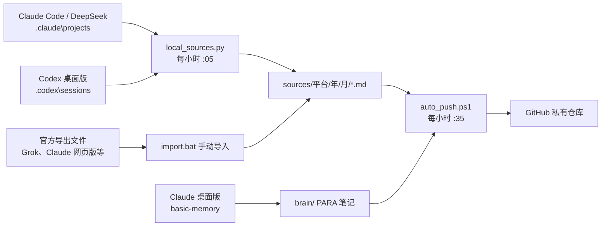

# ai-knowledge：个人 AI 第二大脑

> **English:** A personal "AI second brain". It converts your conversations from ChatGPT/Codex, Claude, Grok and DeepSeek (official exports and local desktop-client session files) into Obsidian-compatible Markdown, organizes notes with PARA via basic-memory, and backs everything up to your own **private** GitHub repo on a schedule. Windows + Python 3. MIT licensed.

把 Grok、Claude、ChatGPT、DeepSeek 的聊天统一转成 **Obsidian 兼容的 Markdown**，按平台和月份归档，存进你自己的 GitHub 仓库。

> ⚠️ **隐私提醒**：导入后的对话是你的私人数据。请 fork/clone 本项目后，推送到你自己的 **Private** 仓库，不要把含对话的仓库设为公开。

## 快速开始
```powershell
git clone https://github.com/<your-username>/<your-repo>.git $env:USERPROFILE\ai-knowledge
cd $env:USERPROFILE\ai-knowledge
git remote set-url origin https://github.com/<your-username>/<your-private-repo>.git   # 换成你的私有仓库
python scripts\ai_brain.py --local      # 读取本机客户端会话
```
所有脚本都以脚本所在仓库为根目录，放在哪里都能用。

## 整体结构和原理

一句话：各个 AI 的对话先自动转成 Markdown 文件，放进 ai-knowledge 文件夹，再由定时任务每小时推到 GitHub 备份。



### 仓库结构

```
ai-knowledge/
├── sources/          原始对话，按平台再按年月分
│   ├── claude/
│   ├── chatgpt/
│   ├── deepseek/
│   └── grok/
├── brain/            整理过的知识笔记（PARA，basic-memory 管理）
│   ├── 0-Inbox/
│   ├── 1-Projects/
│   ├── 2-Areas/
│   ├── 3-Resources/
│   └── 4-Archive/
├── scripts/          转换、本地读取、自动推送脚本
├── .ai_brain/        已处理记录（去重）和日志
├── import.bat        手动导入官方导出文件
└── README.md
```

### 原理

1. **自动收集**：Claude Code 和 Codex 把每次对话存成 JSONL 放在本机。`local_sources.py` 每小时复制出来读取，只保留你和 AI 的对话，转成 Markdown；已处理过且没变化的文件会跳过。
2. **手动补充**：Grok、Claude 网页版的对话存在服务器上，需从官网导出后用 `import.bat` 导入，走同一套转换。
3. **记笔记**：在 Claude 桌面版里让它“记一条笔记”，basic-memory 会写进 `brain/`，以后还能读回来。
4. **备份同步**：`auto_push.ps1` 每小时检查，有变化就提交并推送到 GitHub。

`sources/` 是原始资料库，`brain/` 是加工后的知识库，GitHub 是云端备份。
## 一、各平台怎么导出
| 平台 | 步骤 | 得到 |
|---|---|---|
| ChatGPT | 头像 → 设置 Settings → 数据控制 Data controls → 导出数据 Export → 确认，邮件里下载 | zip（内含 `conversations.json`） |
| Claude | 头像 → Settings → Privacy → Export data，邮件里下载 | zip（内含 `conversations.json`） |
| Grok | https://accounts.x.ai → Data → 下载账户数据，邮件里下载 | zip（内含对话 json） |
| DeepSeek | 网页版 设置 → 数据管理 → 导出所有历史对话 | zip（内含 `conversations.json`） |

> 菜单名可能会变，找不到就在设置里搜 “Export / 导出”。下载链接通常 24 小时内有效。

## 二、日常使用（Windows）
1. 装好 Git 和 Python 3（安装时勾选 Add to PATH），把仓库 `git clone` 到电脑上。
2. 导出的 zip 留在 **下载** 文件夹里。
3. 双击 `import.bat`：自动 拉取 → 扫描下载文件夹 → 转换 → 去重 → 提交 → 推送。
   也可以把某个 zip 直接拖到 `import.bat` 上，只处理这一个。

命令行：
```
python scripts\ai_brain.py                         # 扫描 ~/Downloads，只转换
python scripts\ai_brain.py --src C:\exports        # 换一个扫描文件夹
python scripts\ai_brain.py --file x.zip --push     # 只处理一个文件，并提交推送
python scripts\ai_brain.py --commit                # 转换并本地提交
python scripts\ai_brain.py --platform claude --file x.json   # 认不出平台时手动指定
python scripts\ai_brain.py --force                 # 忽略已处理记录，全部重来
python scripts\check_backup.py .                   # 本地体检（和 GitHub 上的检查一样）
```
- **去重**：每段对话按 `平台:原始id` 识别，再导入只会更新原文件，不会重复。
- **已处理记录**：`.ai_brain/processed.json` 记下处理过的文件（按内容哈希），同一个 zip 不会重复处理。
- 原始 zip **不要**放进仓库（`.gitignore` 已排除）。

## 三、目录结构
```
sources/<平台>/<年>/<年-月>/<日期>-<标题>.md   # 对话
scripts/ai_brain.py          # 主程序
scripts/converters/          # 各平台转换器（一个平台一个文件）
scripts/check_backup.py      # 体检脚本
.github/workflows/backup-check.yml  # 每次 push + 每周一自动体检
```
每个 .md 开头是 YAML：`title`、`platform`、`id`、`created`、`updated`、`messages`、`tags`。用 Obsidian 打开整个仓库文件夹就能当知识库搜索、打标签、双链。

## 四、连不上 GitHub 时
如果你有代理，把地址和端口换成你自己的（下面只是格式示例）：
```
git config --global http.proxy  http://代理地址:端口
git config --global https.proxy http://代理地址:端口
# 不用时取消
git config --global --unset http.proxy
git config --global --unset https.proxy
```

## 五、怎么新增一个平台（例如 Gemini）
在 `scripts/converters/` 新建 `gemini.py`，写三样东西，程序会自动加载：
```python
from .common import ts, text_of
NAME = "gemini"                      # 也是 sources/ 下的文件夹名
def detect(filename, data):          # 是这个平台的导出就返回 True
    return isinstance(data, list) and data and "header" in data[0]
def convert(data):                   # 每段对话 yield 一个 dict
    for c in data:
        yield dict(id=..., title=..., created=ts(...), updated=ts(...),
                   messages=[("user", "问题", ts(...)), ("assistant", "回答", "")])
```
然后建 `sources/gemini/.gitkeep`，用一个小的测试文件跑一下 `python scripts/ai_brain.py --file 测试.json` 就行。

## basic-memory（Claude 桌面版的长期记忆）

- 只管 `brain/` 文件夹（PARA：0-Inbox / 1-Projects / 2-Areas / 3-Resources / 4-Archive），不碰 `sources/` 里的原始聊天。
- 安装：`uv tool install basic-memory --prerelease=allow --python 3.12`，项目：`basic-memory project add ai-knowledge %USERPROFILE%\ai-knowledge\brain`（路径换成你的仓库位置）。
- Claude 桌面版配置（商店版路径）：`%LOCALAPPDATA%\Packages\Claude_<id>\LocalCache\Roaming\Claude\claude_desktop_config.json`（修改前先备份）。
- 测试：完全退出并重开 Claude 桌面版，说"用 basic-memory 在 0-Inbox 记一条笔记：测试"，然后看 `brain/0-Inbox/` 是否出现 .md 文件。
- 支持：Claude 桌面版、Claude Code、Cursor、VS Code 等支持 MCP 的本地客户端。Grok、DeepSeek 网页/App 不支持；ChatGPT 只能用付费云服务。
- 笔记不会自动提交到 GitHub，需要手动 commit/push（或运行 import 脚本时一并提交）。
- 如下载失败，可给 uv 设置代理：`$env:HTTPS_PROXY="http://127.0.0.1:端口"`。

## 本机客户端会话自动导入（无需手动导出）

`python scripts/ai_brain.py --local` 直接读取本机 AI 客户端保存的会话（只读：先复制到临时目录再解析，不修改任何应用文件），转成 Markdown 存到 `sources/<平台>/`。按文件修改时间+大小增量处理，记录在 `.ai_brain/processed.json`；会话继续后会自动更新同一个 md。常见密钥格式会替换成 `[REDACTED]`，工具调用输出不导出。

| 来源 | 本机路径 | 格式 | 存入 |
|---|---|---|---|
| Claude Code / Claude 桌面版「Code」标签 | `~/.claude/projects/**/*.jsonl`（标题取自 `%LOCALAPPDATA%\Packages\Claude_*\LocalCache\Roaming\Claude\claude-code-sessions`） | JSONL | `sources/claude/` |
| DeepSeek（通过 Claude Code，`ANTHROPIC_BASE_URL=api.deepseek.com`） | 同上，按 model=deepseek-* 区分 | JSONL | `sources/deepseek/` |
| ChatGPT / Codex 桌面版 | `~/.codex/sessions/**/rollout-*.jsonl(.zst)`，标题 `~/.codex/session_index.jsonl` | JSONL / zstd 压缩 JSONL | `sources/chatgpt/` |

本地读不到的来源：
- **Claude 桌面版「聊天」标签**：会话存在 claude.ai 服务器，本地 IndexedDB 只有少量缓存，无完整消息 → 仍需官方导出后用 `ai_brain.py` 导入。
- **Grok**：暂无 Grok 桌面客户端，网页版数据在服务器 → 用官方导出。
- **VS Code DeepSeek 插件**：暂未支持；如通过 Claude Code 接 DeepSeek，已覆盖。

`.zst` 压缩会话需要 `zstandard`，脚本通过 `uv run --with zstandard` 自动获取（无需 pip）；直接用 `python` 运行时会跳过 .zst 并提示。

### 定时任务（Windows 任务计划，用户级，无需管理员）

在仓库根目录用 PowerShell 注册两个每小时任务：
```powershell
$repo = (Get-Location).Path
$ps = "powershell.exe"
$a1 = New-ScheduledTaskAction -Execute $ps -Argument "-NoProfile -WindowStyle Hidden -ExecutionPolicy Bypass -File `"$repo\scripts\run_local_import.ps1`""
$a2 = New-ScheduledTaskAction -Execute $ps -Argument "-NoProfile -WindowStyle Hidden -ExecutionPolicy Bypass -File `"$repo\scripts\auto_push.ps1`""
$t1 = New-ScheduledTaskTrigger -Once -At (Get-Date).Date.AddMinutes(5)  -RepetitionInterval (New-TimeSpan -Hours 1)
$t2 = New-ScheduledTaskTrigger -Once -At (Get-Date).Date.AddMinutes(35) -RepetitionInterval (New-TimeSpan -Hours 1)
Register-ScheduledTask ai-knowledge-local-import -Action $a1 -Trigger $t1
Register-ScheduledTask ai-knowledge-autopush     -Action $a2 -Trigger $t2
```

| 任务名 | 频率 | 做什么 |
|---|---|---|
| `ai-knowledge-local-import` | 每小时 :05 | `scripts/run_local_import.ps1`：本机会话 → Markdown，然后调用 auto_push |
| `ai-knowledge-autopush` | 每小时 :35 | `scripts/auto_push.ps1`：`git add -A` → 有改动才 commit（`auto: 时间`）→ `pull --rebase` → `push` |

日志：`.ai_brain/local_import.log`、`.ai_brain/auto_push.log`。如需代理：设置用户环境变量 `HTTPS_PROXY=http://127.0.0.1:端口`。

```powershell
Get-ScheduledTask ai-knowledge-* | Get-ScheduledTaskInfo   # 查看状态
Start-ScheduledTask ai-knowledge-autopush                  # 立即运行
Disable-ScheduledTask ai-knowledge-autopush                # 暂停（Enable 恢复）
Unregister-ScheduledTask ai-knowledge-autopush -Confirm:$false   # 删除
```

## 注意
- 含对话的仓库必须保持 **Private**。
- 不要提交密码或 API 密钥；体检脚本会拦下疑似密钥和压缩包。
- 各平台导出格式可能变化，第一次导入后请抽查几个文件。

## License
MIT，见 [LICENSE](LICENSE)。